<h1 align="center">📝 Hệ thống Thi Trắc nghiệm trên Console</h1>

<p align="center">
  <b>Quản lý lớp – sinh viên – môn học – câu hỏi và tổ chức thi trắc nghiệm có đồng hồ đếm ngược, viết bằng C++ thuần (không dùng STL container).</b>
</p>

<p align="center">
  
  
  
  
</p>

---

## 📑 Mục lục

1. [Thông tin đồ án](#-thông-tin-đồ-án)
2. [Tính năng](#-tính-năng)
3. [Cài đặt và chạy](#-cài-đặt--chạy)
4. [Giao diện và phím tắt](#-giao-diện--phím-tắt)
5. [Quy trình thi trắc nghiệm](#-quy-trình-thi-trắc-nghiệm)
6. [Ràng buộc toàn vẹn dữ liệu](#-ràng-buộc-toàn-vẹn-dữ-liệu)
7. [Kiến trúc và cấu trúc dữ liệu](#-kiến-trúc--cấu-trúc-dữ-liệu)
8. [File dữ liệu](#-file-dữ-liệu)
9. [Cấu trúc mã nguồn](#-cấu-trúc-mã-nguồn)
10. [Giới hạn hệ thống](#-giới-hạn-hệ-thống)

---

## 🎓 Thông tin đồ án

|                                     | Nội dung                                                                     |
| ----------------------------------- | ----------------------------------------------------------------------------- |
| **Tên đồ án**             | HỆ THỐNG THI TRẮC NGHIỆM                                                  |
| **Tác giả**                 | Phạm Kim Lâm Vy                                                             |
| **Môn học**                 | Cấu trúc dữ liệu và giải thuật                                         |
| **Giảng viên hướng dẫn** | Thầy Lưu Nguyễn Kỳ Thư                                                   |
| **Trường**                  | Học viện Công nghệ Bưu chính Viễn thông – Cơ sở TP. Hồ Chí Minh |
| **Năm học**                 | 2026 – 2027                                                                  |

---

## ✨ Tính năng

### 👨‍🏫 Giảng viên

Bốn mục quản lý dưới đây đều hỗ trợ đầy đủ: **in danh sách, thêm, sửa, xóa, tìm kiếm**.

- **Quản lý lớp:** in danh sách, thêm, sửa, xóa, tìm kiếm. Nhấn `Enter` vào một lớp để quản lý danh sách sinh viên của lớp đó.
- **Quản lý sinh viên theo lớp:** mã SV, họ, tên, phái.
- **Quản lý môn học:** nhấn `Enter` vào một môn để nhập câu hỏi.
- **Quản lý câu hỏi trắc nghiệm:** nội dung, 4 đáp án A/B/C/D, đáp án đúng. Nhấn `Enter` để xem chi tiết câu hỏi.
- **In bảng điểm** của một môn theo một lớp (sinh viên chưa thi hiển thị `Chua thi`).
- **In chi tiết bài thi** của sinh viên với mã màu:
  - 🟢 đáp án đúng
  - 🔴 đáp án sinh viên chọn sai
  - 🟡 câu bỏ trống

### 🎒 Sinh viên

- Đăng nhập bằng mã SV, xem thông tin cá nhân.
- Chọn môn, nhập số câu và số phút rồi làm bài thi trắc nghiệm.
- Xem kết quả ngay khi nộp bài: số câu đúng / sai / bỏ trống và điểm thang 10.

### 🖼️ Ảnh minh họa

<table>
  <tr>
    <th align="center" width="33%">Đăng nhập</th>
    <th align="center" width="33%">Menu giảng viên</th>
    <th align="center" width="34%">Menu sinh viên</th>
  </tr>
  <tr>
    <td align="center" valign="top">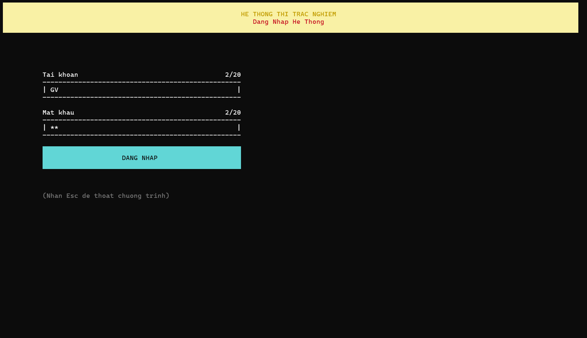</td>
    <td align="center" valign="top">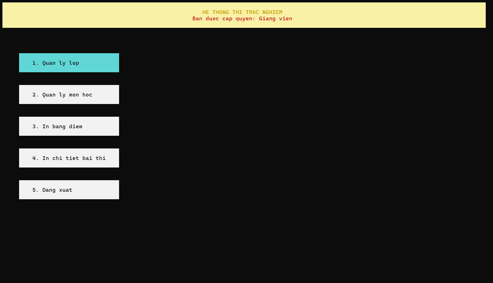</td>
    <td align="center" valign="top">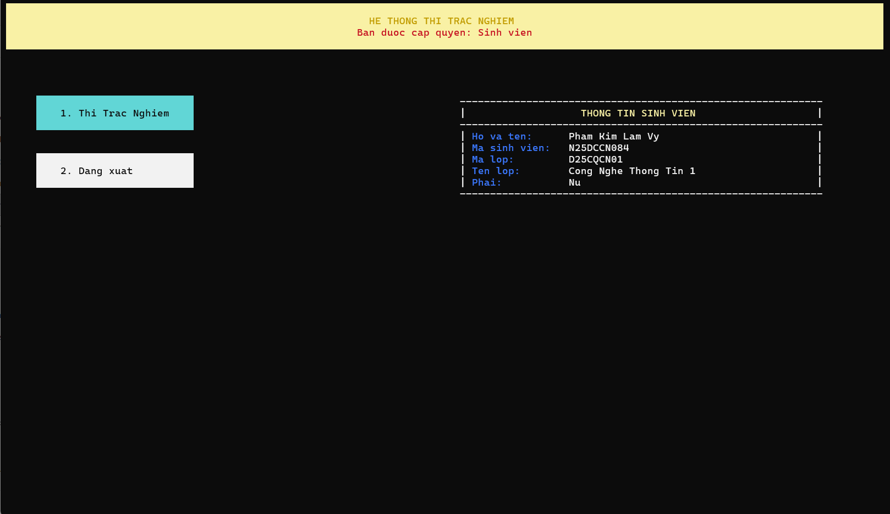</td>
  </tr>
</table>

### 🔑 Tài khoản mặc định

| Vai trò     | Tài khoản                   | Mật khẩu                                                 |
| ------------ | ----------------------------- | ---------------------------------------------------------- |
| Giảng viên | `GV`                        | `GV`                                                     |
| Sinh viên   | Mã SV trong `sinhvien.txt` | Giá trị cột `MATKHAU` của sinh viên đó trong file |

**Cách mật khẩu sinh viên được tạo:**

* **Thêm sinh viên từ chương trình:** mật khẩu được khởi tạo mặc định là `123456` và ghi vào cột `MATKHAU` khi bấm `F2` lưu.
* **Sửa trực tiếp trong `data/sinhvien.txt`:** mật khẩu đăng nhập chính là giá trị cột `MATKHAU` của sinh viên đó trong file (chi tiết xem tại [File dữ liệu](#-file-dữ-liệu)).

---

## 🚀 Cài đặt & chạy

### Yêu cầu

- **Hệ điều hành:** Windows (dùng `windows.h`, `conio.h`)
- **Trình biên dịch:** MinGW `g++` hỗ trợ **C++17** (Makefile biên dịch với `-std=c++17`) – đã thử với `g++ 9.2.0`
- **Console:** rộng tối thiểu **145 cột × 44 dòng**

### Chạy

```bash
mingw32-make run      # build (nếu cần) rồi chạy luôn
# hoặc
ThiTracNghiem.exe
```

### Dọn dẹp

```bash
mingw32-make clean    # xóa obj/*.o, obj/*.d và ThiTracNghiem.exe
```

### ⚠️ Lưu ý khi chạy

- Thư mục **`data/`** phải nằm cạnh file `.exe`, chứa các file `.txt` mô tả ở mục [File dữ liệu](#-file-dữ-liệu).
- Chương trình **không tự chỉnh kích thước cửa sổ**. Hãy **phóng to cửa sổ console** hoặc **giảm cỡ chữ** để đạt tối thiểu 145 × 44, nếu không giao diện sẽ bị vỡ.

---

## 🖥️ Giao diện & phím tắt

Các màn hình quản lý (**Lớp, Sinh viên, Môn học, Câu hỏi**) dùng chung một kiểu bố cục: **bảng bên trái, form bên phải, có phân trang**.

<p align="center">
  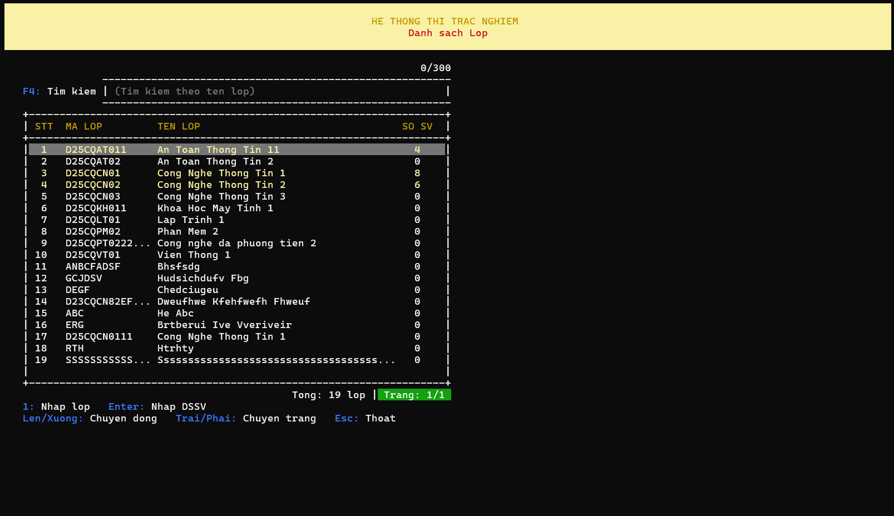
</p>

### Phím tắt

| Phím         | Tác dụng                                                           |
| ------------- | -------------------------------------------------------------------- |
| `1`         | Vào giao diện thêm, xóa, sửa                                    |
| `F1`        | Thêm                                                                |
| `F3`        | Sửa (chọn dòng rồi `Enter` để mở form)                      |
| `Delete`    | Xóa (`Enter` để đánh dấu nhiều dòng, `Delete` để xóa) |
| `F2`        | Lưu xuống file                                                     |
| `F4`        | Tìm kiếm / lọc theo từ khóa                                     |
| `Enter`     | Vào màn hình con (Lớp → DSSV, Môn → Câu hỏi) hoặc chọn    |
| `↑` `↓` | Chuyển dòng                                                        |
| `←` `→` | Chuyển trang                                                        |
| `Esc`       | Thoát / hủy                                                        |

### Lưu ý

- **Thao tác trên bộ nhớ, lưu khi cần:** Thêm / sửa / xóa áp dụng ngay trên RAM. Dòng chưa lưu được tô **xanh lá** cho tới khi bấm `F2`.
- **Chống mất dữ liệu khi thoát:** `Esc` khi còn thay đổi chưa lưu sẽ hiện hộp thoại 3 nút: `LUU VA THOAT` / `THOAT` / `HUY`. Chọn thoát không lưu thì dữ liệu được nạp lại từ file.
- **Tìm kiếm tức thời:** ô `F4` lọc ngay khi gõ, không phân biệt hoa/thường, kết quả khớp đầu chuỗi được xếp trước. Không có kết quả thì báo `Khong co ket qua phu hop!`.
- **Form tự lọc ký tự theo từng loại ô:** mã chỉ nhận chữ + số và tự in hoa; họ tên tự viết hoa chữ đầu mỗi từ; đáp án chỉ nhận A–D; ký tự `|` bị chặn để bảo vệ định dạng file.
- **In bảng điểm / chi tiết bài thi** (2 bảng song song): `Enter` đánh dấu, `Space` chuyển bảng, `F2` in, `Esc` thoát.

### Ảnh minh họa

<table>
  <tr>
    <th align="center" width="48%">Quản lý sinh viên</th>
    <th align="center" width="52%">Quản lý môn học</th>
  </tr>
  <tr>
    <td align="center" valign="top">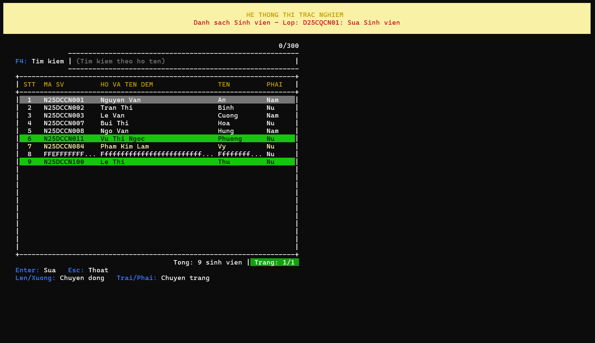</td>
    <td align="center" valign="top">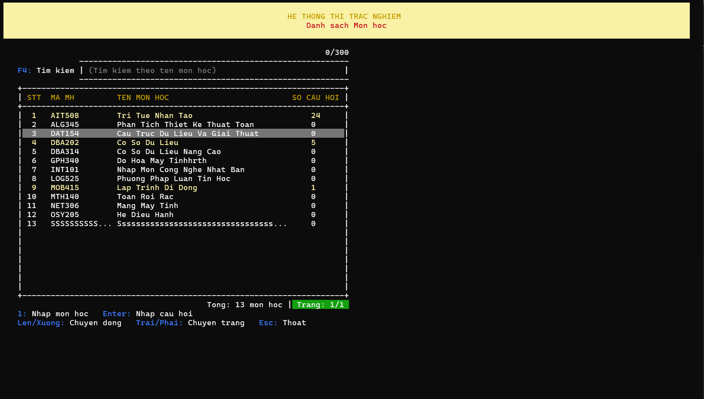</td>
  </tr>
  <tr>
    <td align="center" valign="top"><i>Dòng xanh lá: chưa lưu<br>Dòng vàng: bị khóa, không thể sửa/xóa</i></td>
    <td align="center" valign="top"><i>Enter vào một môn để nhập câu hỏi</i></td>
  </tr>
  <tr>
    <td align="center" valign="top"><b>Nhập câu hỏi</b></td>
    <td align="center" valign="top"><b>Xem chi tiết câu hỏi</b></td>
  </tr>
  <tr>
    <td align="center" valign="top">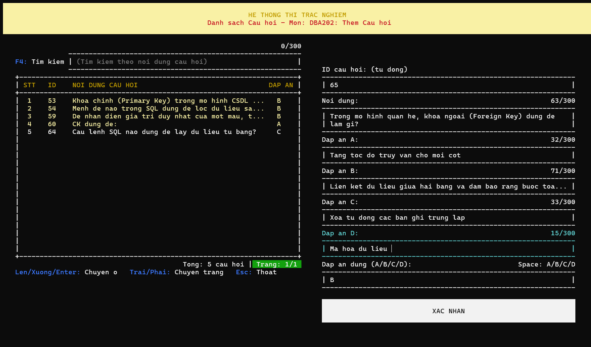</td>
    <td align="center" valign="top">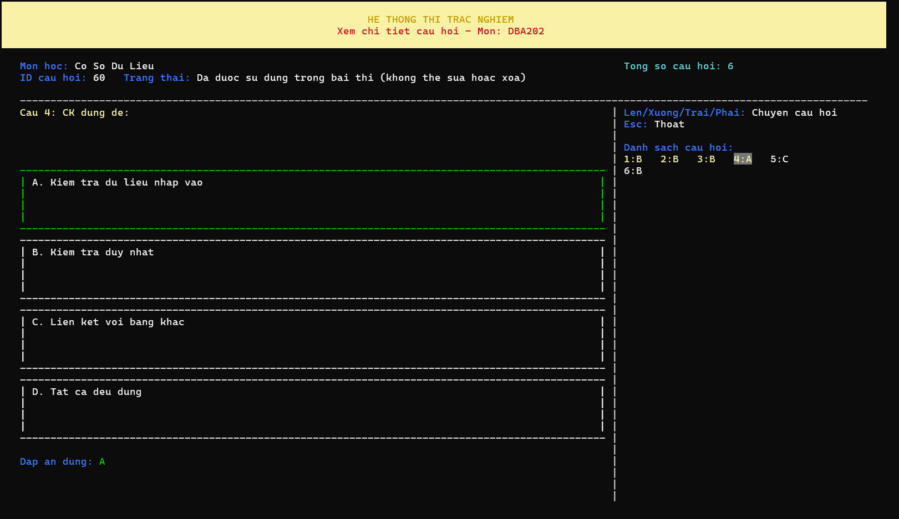</td>
  </tr>
</table>

<table>
  <tr>
    <th align="center" width="50%">Tìm kiếm (<code>F4</code>)</th>
    <th align="center" width="50%">Hộp thoại lưu khi thoát (<code>Esc</code>)</th>
  </tr>
  <tr>
    <td align="center" valign="top">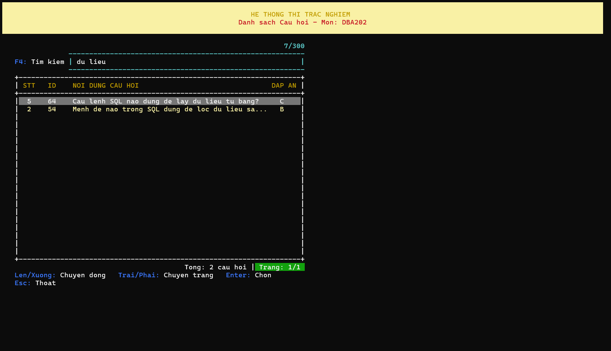</td>
    <td align="center" valign="top">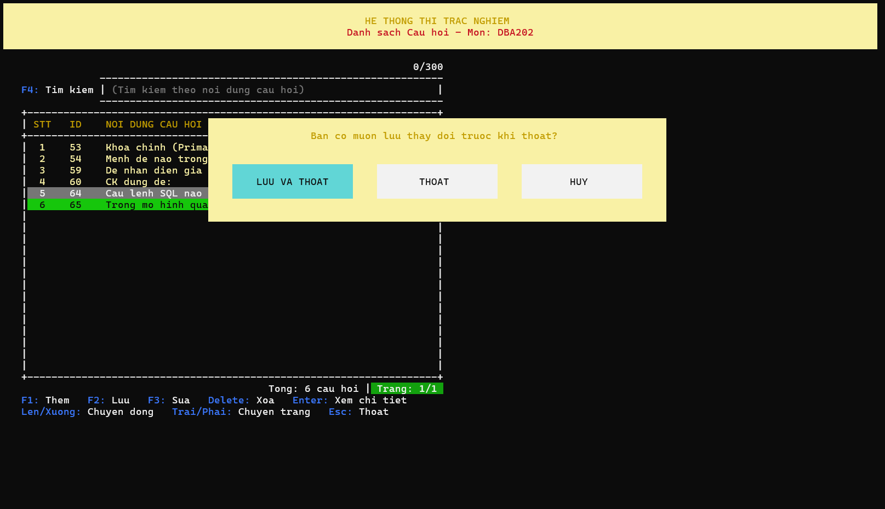</td>
  </tr>
</table>

### Báo cáo điểm

<table>
  <tr>
    <th align="center" width="50%">In bảng điểm</th>
    <th align="center" width="50%">Chi tiết bài thi</th>
  </tr>
  <tr>
    <td align="center" valign="top">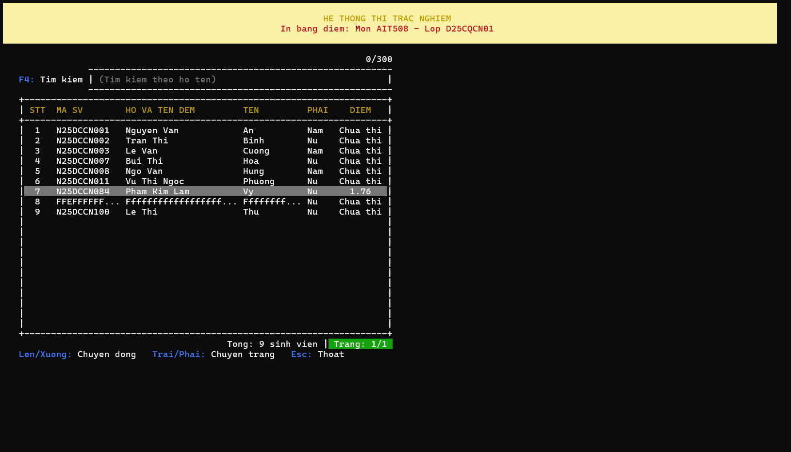</td>
    <td align="center" valign="top">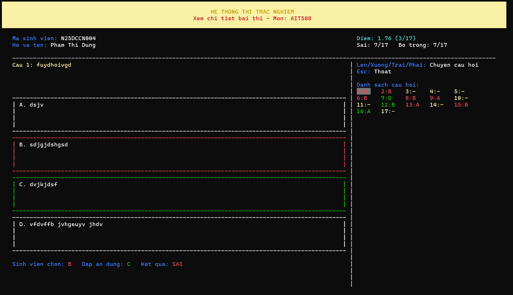</td>
  </tr>
</table>

---

## 🧪 Quy trình thi trắc nghiệm

1. Sinh viên chọn môn, nhập **số câu** (tối đa bằng số câu của môn) và **số phút** (tối đa 180).
2. Hệ thống **bốc ngẫu nhiên không lặp** số câu đã chọn và **xáo thứ tự đáp án** A/B/C/D bằng thuật toán **Fisher–Yates**.
3. **Màn hình thi:** câu hỏi và 4 đáp án bên trái; lưới số câu bên phải (🟩 đã trả lời, ⬜ chưa trả lời); đồng hồ đếm ngược.
4. **Phím điều khiển:**| Phím                   |                     Tác dụng                     |
5. | ----------------------- | :------------------------------------------------: |
   | `A` `B` `C` `D` |                  Chọn đáp án                  |
   | `←` `→`           |       Đổi một câu trong danh sách câu       |
   | `↑` `↓`           |       Đổi hàng trong danh sách câu hỏi       |
   | `Esc`                 | Nộp bài (hỏi xác nhận, đồng hồ vẫn chạy) |
6. **Hết giờ tự động nộp bài.** Điểm = `số câu đúng × 10 / số câu`, làm tròn 2 chữ số, lưu ngay vào `diem.txt`.
7. Nhấn phím bất kỳ ở màn hình kết quả để quay lại màn hình chọn môn. **Môn vừa thi bị khóa, không thi lại.**

<table>
  <tr>
    <th align="center" width="33%">Chọn môn thi</th>
    <th align="center" width="33%">Đang thi</th>
    <th align="center" width="34%">Kết quả</th>
  </tr>
  <tr>
    <td align="center" valign="top">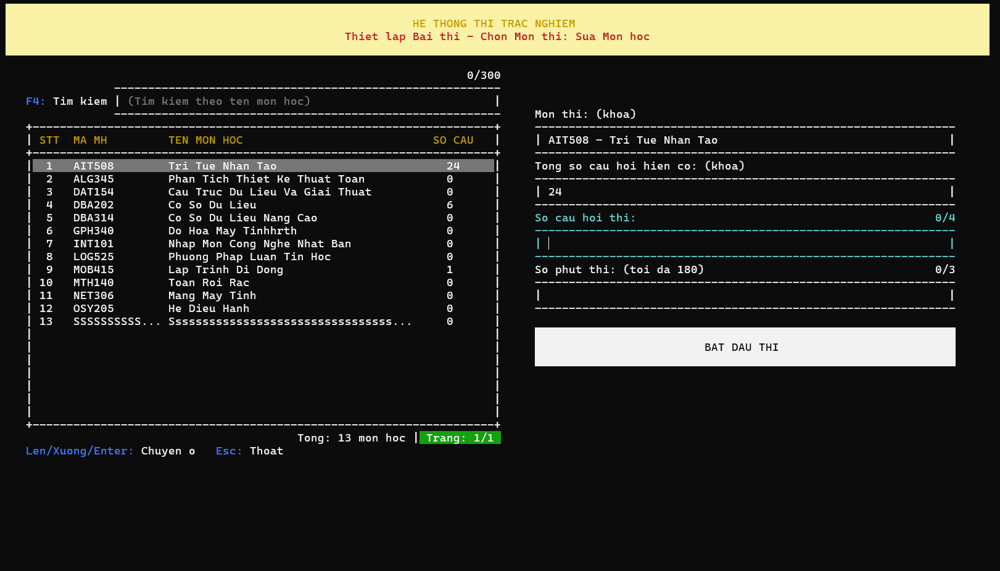</td>
    <td align="center" valign="top">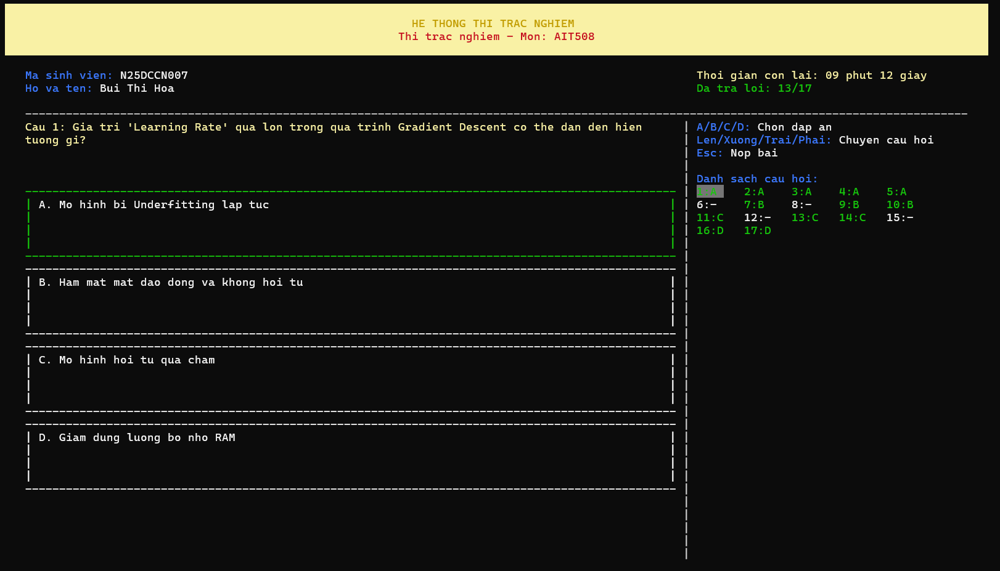</td>
    <td align="center" valign="top">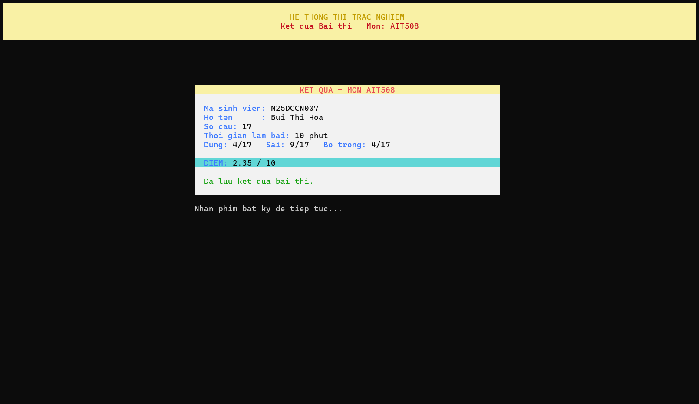</td>
  </tr>
</table>

### 🛡️ Chống mất bài khi sự cố

Mỗi lần sinh viên đổi đáp án, phiên thi được ghi vào `data/dangthi.txt` kèm **mốc kết thúc tính theo Unix timestamp**:

- Mất điện hoặc tắt chương trình → đăng nhập lại sẽ **vào thẳng bài đang làm**.
- Thời gian tính theo giờ hệ thống nên đồng hồ vẫn "chạy" khi tắt máy.
- Nếu đã quá giờ lúc khởi động lại chương trình, bài thi **được tự động chấm** và lưu điểm.

---

## 🔒 Ràng buộc toàn vẹn dữ liệu

**Khóa sửa/xóa** để tránh mất liên kết dữ liệu:

| Đối tượng | Bị khóa khi                                                                   |
| ------------- | ------------------------------------------------------------------------------- |
| Lớp          | Đã có sinh viên                                                             |
| Sinh viên    | Đã có điểm, hoặc đang có bài thi chưa xong                            |
| Môn học     | Đã có câu hỏi                                                              |
| Câu hỏi     | Đã được bốc vào bài thi (đã thi xong hoặc nằm trong bài đang thi) |

**Kiểm tra trùng:** mã lớp, mã SV (trên toàn hệ thống), mã môn; 4 đáp án của một câu hỏi không được trùng nhau.

---

## 🏗️ Kiến trúc & cấu trúc dữ liệu

### Kiến trúc phân lớp

```text
┌───────────────────────────────────────────────────────────────┐
│  UI ENGINE  (UI.h, UI.cpp)                                    │
│  Máy trạng thái ChayManHinhNhap · Bảng lọc · Form · Hộp thoại │
└───────────────────────────────┬───────────────────────────────┘
                                │  interface IManHinhNhap
┌───────────────────────────────▼───────────────────────────────┐
│  BUSINESS LOGIC                                               │
│  DangNhap · Lop · SinhVien · MonHoc · CauHoi · Thi · Diem     │
│  Snapshot & Rollback · Referential Integrity Locks            │
└───────────────────────────────┬───────────────────────────────┘
                                │
┌───────────────────────────────▼───────────────────────────────┐
│  IN-MEMORY DATA STRUCTURES  (KhaiBao.h, mylib.h)              │
│  Mảng con trỏ · Danh sách liên kết đơn · BST                  │
└───────────────────────────────┬───────────────────────────────┘
                                │  file text phân tách bằng '|'
┌───────────────────────────────▼───────────────────────────────┐
│  PERSISTENCE  (data/*.txt)                                    │
└───────────────────────────────────────────────────────────────┘
```

### Cấu trúc dữ liệu trong bộ nhớ

> **Không dùng STL container** cho dữ liệu nghiệp vụ. Các thao tác dùng chung (thêm cuối, đếm, gỡ nút, sao chép snapshot…) được viết thành **template** trong `mylib.h`.

| Dữ liệu                  | Cấu trúc                                                                                     |
| -------------------------- | ---------------------------------------------------------------------------------------------- |
| Danh sách lớp            | Mảng con trỏ `LOP*` (tối đa 10.000)                                                      |
| Sinh viên của lớp       | Danh sách liên kết đơn                                                                    |
| Môn học                  | Cây nhị phân tìm kiếm (BST) theo mã môn                                                 |
| Câu hỏi của môn        | Danh sách liên kết đơn                                                                    |
| Điểm thi của sinh viên | Danh sách liên kết đơn (`DIEMTHI`)                                                      |
| Chi tiết bài thi         | Danh sách liên kết đơn (`CTBT`: id câu, thứ tự đáp án đã xáo, đáp án chọn) |

```text
DsLOP (mảng con trỏ)
  └── LOP ──► SINHVIEN (DSLK) ──► DIEMTHI (DSLK) ──► CTBT (DSLK)

treeMH (BST theo MAMH)
  └── MONHOC ──► CAUHOI (DSLK)
```

### Thiết kế & thuật toán

- **Strategy / Template Method – `IManHinhNhap`:** mỗi màn hình quản lý chỉ cài đặt thêm / sửa / xóa / lưu / snapshot; toàn bộ giao diện do `ChayManHinhNhap` đảm nhiệm. Nhờ vậy **4 màn hình dùng chung một bộ máy UI**.
- **Máy trạng thái giao diện:** 7 trạng thái `MAN_HINH_XEM`, `MAN_HINH_CHO`, `FORM_THEM`, `FORM_SUA`, `FORM_SUA_CHO`, `TIM_KIEM`, `CHE_DO_XOA`.
- **Snapshot & hoàn tác:** giữ bản sao dữ liệu lúc mở / lưu gần nhất để xác định dòng nào "chưa lưu" và khôi phục khi thoát không lưu.
- **Dirty-checking rendering:** chỉ vẽ lại dòng / vùng có thay đổi để chống nháy màn hình; hộp thoại dùng `ReadConsoleOutputA` / `WriteConsoleOutputA` để chụp và khôi phục vùng nền.
- **Merge Sort** sắp xếp kết quả tìm kiếm theo vị trí xuất hiện của từ khóa.
- **Fisher–Yates** xáo đáp án; bốc câu hỏi ngẫu nhiên không lặp.
- **Duyệt BST theo LNR** để đưa môn học vào mảng động khi hiển thị bảng.
- **Đánh dấu xóa hàng loạt an toàn:** danh sách đánh dấu luôn giữ thứ tự giảm dần theo chỉ số, nên xóa nhiều phần tử không làm lệch chỉ số.
- **Tránh con trỏ treo:** các lớp nghiệp vụ con chỉ lưu khóa (`maLop`, `maMH`) thay vì con trỏ trực tiếp, an toàn khi dữ liệu được giải phóng và nạp lại từ file.

---

## 📂 File dữ liệu

Nằm trong thư mục `data/`, các trường ngăn cách bằng `|`. Chương trình đọc file khi khởi động và ghi lại khi bấm lưu. **Dòng sai định dạng sẽ bị bỏ qua.**

| File             | Định dạng                                  |
| ---------------- | --------------------------------------------- |
| `lop.txt`      | `MALOP\|TENLOP`                              |
| `sinhvien.txt` | `MALOP\|MASV\|HO\|TEN\|PHAI\|MATKHAU`            |
| `monhoc.txt`   | `MAMH\|TENMH`                                |
| `cauhoi.txt`   | `MAMH\|ID\|NOIDUNG\|DA1\|DA2\|DA3\|DA4\|DAPANDUNG` |
| `diem.txt`     | `MALOP\|MASV\|MAMH\|DIEM\|CHITIET`              |
| `dangthi.txt`  | `MALOP\|MASV\|MAMH\|SOPHUT\|KETTHUC\|CHITIET`    |

`CHITIET` có dạng `id:thutudapan:chon;...`, ví dụ:

```text
12:3142:A;7:1234:-
```

- `id`: mã câu hỏi · `thutudapan`: thứ tự đáp án sau khi xáo · `chon`: đáp án sinh viên chọn (`-` là bỏ trống).
- `KETTHUC`: thời điểm kết thúc, tính bằng **giây kể từ 1970** (Unix timestamp).

---

## 🗂️ Cấu trúc mã nguồn

```text
.
├── inc/        # Header (.h)
├── src/        # Source (.cpp)
├── data/       # File dữ liệu (.txt)
├── images/     # Ảnh minh họa
└── Makefile
```

| File                                                              | Vai trò                                                                            |
| ----------------------------------------------------------------- | ----------------------------------------------------------------------------------- |
| `main.cpp`                                                      | Khởi động, nạp dữ liệu, xử lý bài thi hết hạn, menu GV / SV              |
| `UI.h` / `UI.cpp`                                             | Bộ máy giao diện: vẽ console, bảng, form, hộp thoại, tìm kiếm, phân trang |
| `DangNhap.h` / `.cpp`                                         | Xác thực giảng viên / sinh viên                                                |
| `Lop`, `SinhVien`, `MonHoc`, `CauHoi` (`.h` / `.cpp`) | Nghiệp vụ từng đối tượng: đọc/ghi file, kiểm tra, khóa                   |
| `Thi.h` / `Thi.cpp`                                           | Màn hình thi, đồng hồ, chấm điểm, phiên thi dang dở                       |
| `Diem.h` / `Diem.cpp`                                         | Điểm, chi tiết bài thi, phiên thi, in bảng điểm                             |
| `KhaiBao.h`                                                     | Khai báo `struct` và hằng số                                                  |
| `mylib.h`                                                       | Tiện ích: `gotoxy`, xử lý chuỗi, đọc file theo dòng, template danh sách  |

### Luồng khởi động

1. `NapDuLieu` – đọc `lop.txt` → `sinhvien.txt` → `diem.txt`.
2. `NapMonHoc` – đọc `monhoc.txt` → `cauhoi.txt`, rồi đánh dấu các câu hỏi đã thi.
3. `XuLyBaiThiHetHan` – chấm và lưu các phiên thi đã quá hạn trong lúc tắt máy.
4. Vòng lặp đăng nhập → `MenuGV` / `MenuSV`. Sinh viên còn bài dang dở sẽ vào thẳng bài thi.

---

## 📏 Giới hạn hệ thống

| Mục                    | Giá trị                                                    |
| ----------------------- | ------------------------------------------------------------ |
| Số lớp tối đa       | 10.000                                                       |
| Thời gian thi tối đa | 180 phút                                                    |
| ID câu hỏi            | Tự tăng, tối đa 1.000.000, không trùng giữa các môn |
| Số dòng mỗi trang    | 20 (mặc định)                                             |
| Kích thước console   | Tối thiểu 145 cột × 44 dòng                             |

### Độ dài tối đa của các trường nhập

| Trường                      | Số ký tự tối đa |
| ----------------------------- | :------------------: |
| Mã lớp                      |          15          |
| Tên lớp                     |          50          |
| Mã sinh viên                |          15          |
| Họ và tên đệm sinh viên |          50          |
| Tên sinh viên               |          15          |
| Mật khẩu                    |          20          |
| Mã môn học                 |          15          |
| Tên môn học                |          50          |
| Nội dung câu hỏi           |         300         |
| Mỗi đáp án (A/B/C/D)      |         300         |
| Ô tìm kiếm (`F4`)        |         300         |

---

<div align="center">
